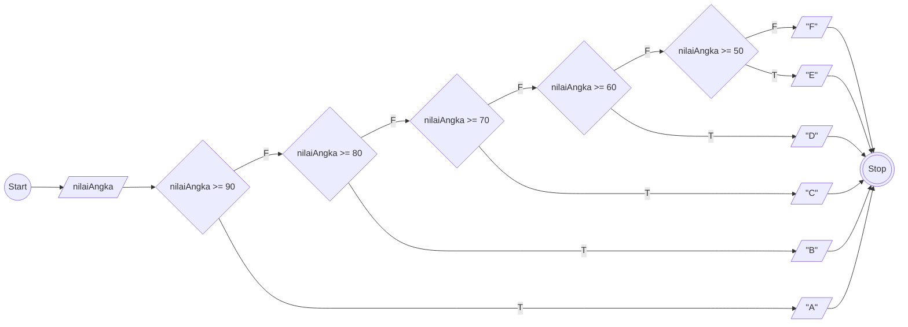

# Algoritma Implementasi Program Menghitung Nilai Angka ke dalam Huruf

## Deskriptif
1. Start
1. Input nilai angka
1. Jika nilai angka 90-100, maka nilai huruf "A", lalu output nilai huruf;
1. Jika nilai angka 80-89, maka nilai huruf "B", lalu output nilai huruf;
1. Jika nilai angka 70-79, maka nilai huruf "C", lalu output nilai huruf;
1. Jika nilai angka 60-69, maka nilai huruf "D", lalu output nilai huruf;
1. Jika nilai angka 50-59, maka nilai huruf "E", lalu output nilai huruf;
1. Jika nilai angka 0-49, maka nilai huruf "F", lalu output nilai huruf;
1. Stop

## Flowchart


## Pseudo-code
```
DECLARE nilaiAngka: INTEGER
DECLARE nilaiHuruf: STRING

INPUT nilaiAngka

IF nilaiAngka >= 90 THEN
    nilaiHuruf <- 'A'
    WRITE <- nilaiHuruf
ELSE
    IF nilaiAngka >= 80 THEN
        nilaiHuruf <- 'B'
        WRITE <- nilaiHuruf
    ELSE
        IF nilaiAngka >= 70 THEN
            nilaiHuruf <- 'C'
            WRITE <- nilaiHuruf
        ELSE
            IF nilaiAngka >= 60 THEN
                nilaiHuruf <- 'D'
                WRITE <- nilaiHuruf
            ELSE
                IF nilaiAngka >= 50 THEN
                    nilaiHuruf <- 'E'
                    WRITE <- nilaiHuruf
                ELSE
                    nilaiHuruf <- 'F'
                    WRITE <- nilaiHuruf
                ENDIF
            ENDIF
        ENDIF
    ENDIF
ENDIF
```